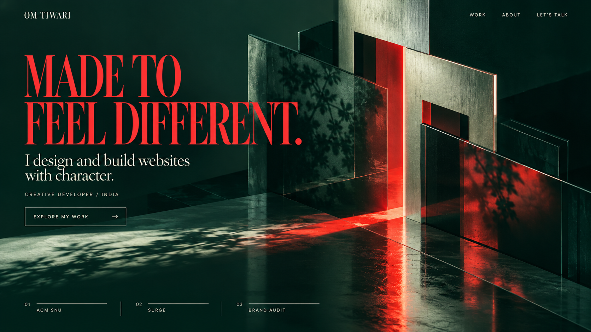

# Om Tiwari — Green Living Poster implementation plan

**Decision date:** 27 October 2026  
**Status:** Implemented locally on 27 October 2026; see [IMPLEMENTATION_STATUS.md](IMPLEMENTATION_STATUS.md) and [VALIDATION.md](VALIDATION.md)
**Owner:** Om Tiwari  
**Selected direction:** Living poster · petrol green, metallic sage, scarlet and ivory  
**Technical approach:** Responsive artwork with live HTML/CSS typography and controlled layered motion  
**Existing foundation:** Next.js App Router, TypeScript, CSS Modules, GSAP/ScrollTrigger

This document preserves the approved pre-implementation plan. Statements about assets not yet produced describe that planning checkpoint; the linked status and asset register describe the completed build.

## 1. The visual target

Om selected this generated study. Use it as the visual target for the opening, not merely as a palette suggestion.

The reference is preserved at `docs/design/green-studio-reference.png`: 1672 × 941 pixels, PNG, SHA-256 `4c739fd0fd7c7d056b63febaf6aa529d454960210cabb6d38c2b9e9bebeee829`.

Preserve its defining relationships:

- A deep green environment fills the frame.
- Mint-metal and smoked-glass architectural planes occupy the right side.
- Scarlet light runs through the structure and reflects across the floor.
- Leaf shadows and material texture add depth without visual clutter.
- Large, upright, high-contrast scarlet serif type anchors the left side.
- Ivory secondary copy and precise navigation sit within the same composition.
- A restrained three-project index sits near the bottom.

The earlier charcoal O, floating gallery, polaroid arrangement and alternate colour studies are historical explorations. They are not the opening to implement.

## 2. Can the image become a working website?

Yes. The selected image supplies an art-direction reference, and its environment can become a real page asset. The text, navigation, buttons, project links and interactions will be rebuilt as normal web elements over that artwork.

The first implementation should use a **layered image approach**, sometimes described as 2.5D: a photographic/rendered background, live foreground typography and UI, and modest lighting, clipping and position changes. This is the closest route to the selected materials and lighting.

A generated PNG does not contain an editable 3D scene, hidden geometry or a depth model. It cannot supply a physically correct camera orbit by itself. This version therefore uses controlled image and lighting motion. A future freely moving 3D scene would be a separate asset-production project.

The goal is a close visual match at the reference desktop proportions, with intentional compositions on other screens. Generated letterforms may not correspond exactly to an available font, so font matching and responsive typesetting are explicit tasks.

### Rendered layers

| Layer | What it contains | How it will work |
| --- | --- | --- |
| Base | Petrol background colour | Immediate CSS fallback while artwork loads |
| Scene | Text-free green architecture, materials, reflections and shadows | Responsive, locally served image assets |
| Lighting | A restrained alternate grade/light treatment | An aligned copy of the same scene, revealed locally by a mask |
| Display copy | Heading and supporting message | Real selectable, accessible HTML text |
| Interface | Name, navigation, CTA, project index, effects control | Real links and buttons |
| Motion | Entrance, pointer reveal, small depth offsets and scroll response | CSS and small GSAP client components |

The full generated screenshot must not be used as the live page with invisible links positioned over its baked-in interface.

## 3. Scope and boundaries

Build the new identity across the homepage, project pages, contact, privacy, recovery page, navigation and footer. Preserve the existing real content and working route structure.

Routes remain:

- `/`
- `/work/acm/`
- `/work/surge/`
- `/work/adobe/`
- `/contact/`
- `/privacy/`
- the designed 404 page

The original O and its long scroll/gallery handoff will be retired. The new opening will not require WebGL to achieve its main appearance.

This planning request does not start application implementation, change the hosting provider, upload source or deploy the site. Once implementation is requested, the milestones below are internal completion checks; they do not require a new permission question after every routine step.

## 4. Preserve the current work before implementation

The existing baseline is pushed as `c5ae0b8f335177728f9dc6e1a2a78d87b87874e3` on `origin/main`. At planning time, the subsequent animation and supplied-media changes were local on the branch now named `motion-and-project-media`.

Before changing the application:

1. Inspect the current diff for any newer owner changes.
2. Save the existing working version as a local Git checkpoint, including the supplied screenshots and motion work.
3. Create `green-living-poster` from that checkpoint.
4. Preserve the current project content, media, contact behaviour and photography data.

Do not reset the checkout or assume the remote baseline contains the later work. No remote push is part of this planning step.

## 5. Asset production comes first

The approved image currently includes all its interface text. A clean background and a mobile composition have **not yet been produced**. These are the first production tasks after the plan.

### Required assets

| Asset | Purpose | Production requirement |
| --- | --- | --- |
| Approved reference | Fixed visual target | Already saved under `docs/design/` |
| Clean desktop master | Main scene without any text or UI | Edit the selected image; preserve its camera, materials, light and structure |
| Clean portrait master | Mobile/tablet scene | Recompose the same environment for a tall canvas and readable text area |
| Desktop delivery variants | Responsive hero loading | AVIF and WebP, approximately 1280, 1920 and 2560 pixels wide where source detail supports them |
| Portrait delivery variants | Responsive narrow-screen loading | AVIF and WebP, approximately 768 and 1080 pixels wide |
| Display font and licence | Live headline matching | Self-host the chosen upright serif and retain its licence |
| Social preview | New identity in shared links | Generate a 1200 × 630 preview from the clean art and final live-copy composition |

Suggested production locations:

- `assets/source/green-studio/`: selected editable/lossless masters and asset notes, outside the public web root.
- `public/media/studio/`: optimised delivery files only.
- `public/fonts/`: selected production font files and licence.

Record actual dimensions, source, format, byte size and crop positions. Requested generation dimensions are targets; verify the tool's actual output. Do not represent an enlarged file as containing new native detail.

### Desktop clean-plate brief

Use the approved green image as the edit target. Remove all words, navigation, numerals, arrows, button borders and bottom index rules. Reconstruct the underlying green background and floor naturally. Preserve the architectural arrangement, red seam, reflections, leaf shadows, camera position and metal/glass texture. Keep a dark, spacious left region for the live headline.

Request a high-resolution landscape master, aiming for approximately 2560 × 1440 if supported. Preserve the approved composition rather than inventing a different green architectural scene.

Inspect especially the former headline, navigation, CTA and bottom-index areas for residual letters, blurred patches, broken shadows or reconstructed texture seams.

### Portrait brief

Use the finished clean desktop master as the visual reference for the same environment. Request a tall composition, approximately 1080 × 1920 if supported. Keep the upper/left region dark enough for three lines of heading. Move the architecture and red reflection into the right/lower area while preserving their character. Keep room for supporting copy, a CTA and the work index.

A portrait composition must not be a blind centre crop of the desktop image.

### Alternate lighting and optional depth

The first cursor effect should reuse the **same image geometry** with a controlled CSS colour/light treatment. This guarantees alignment and avoids a second generated scene drifting under the mask.

A separate foreground cutout is optional after the base hero matches. It would require a matching clean plate behind the removed object and a correctly aligned transparent foreground. Skip that addition if it creates double edges or changes the reference composition. It is not required for the first release.

### Asset completion check

Before homepage construction, the clean desktop image and portrait image must be usable, text-free, legible beneath the planned typography and visually consistent with the reference. Keep originals and selected outputs; never overwrite the approved reference.

## 6. Visual system

### Palette

| Token | Starting value | Purpose |
| --- | --- | --- |
| Petrol | `#082A25` | Main identity and deep surfaces |
| Deep green | `#041B18` | Contrast beneath copy, navigation and footer |
| Metallic sage | `#A4BFB0` | Secondary surfaces, borders and material accents |
| Scarlet | `#EB302B` | Display type, light motif and selected emphasis |
| Ivory | `#F2EDDE` | Body copy, navigation and light sections |
| Soft sage | `#D8E2D8` | Selected project/about surfaces |

These are starting tokens, not permission to recolour the artwork indiscriminately. Match the approved scene's balance. Check text against its actual background, including highlights and pointer states. Scarlet is primarily a large-display accent; small text needs a sufficiently contrasting treatment.

The palette is explicit. It should not change to match the conversation's theme or silently revert to the old charcoal/vermilion identity.

### Typography

- Match the reference's upright, high-contrast editorial display serif. Start with **Bodoni Moda**, then judge rendered glyph proportions, weight, optical size, spacing and line breaks against the reference.
- Bodoni Moda is an available OFL-licensed candidate with weight and optical-size axes; this is a candidate match, not a claim that it generated the reference lettering. See the [official font metadata](https://raw.githubusercontent.com/google/fonts/main/ofl/bodonimoda/METADATA.pb) and [licence](https://raw.githubusercontent.com/google/fonts/main/ofl/bodonimoda/OFL.txt).
- Keep **Space Grotesk** for navigation, metadata, forms and practical reading text.
- Supporting hero copy may use the display serif at a readable size to retain the reference's editorial character.
- Keep production font families to two. The existing italic-only Instrument Serif should not be used as a substitute for the new upright display face.
- Self-host selected files/subsets. Avoid build-time dependency on a remote font request where local files suffice.

Start desktop display type around 110–160px and mobile around 56–76px, adjusting to actual font metrics. Keep body copy around 16–18px and small metadata at least 12px. Preserve hairline clarity at actual device resolution. Do not squash the entire page or turn headings into raster images to force a match.

### Hero copy

Use this starting copy from the selected study:

- Name: **OM TIWARI**
- Headline: **MADE TO / FEEL DIFFERENT.**
- Supporting line: **I design and build websites with character.**
- Descriptor: **CREATIVE DEVELOPER / INDIA**
- CTA: **EXPLORE MY WORK**
- Index: **01 ACM SNU / 02 SURGE / 03 BRAND AUDIT**

Keep Om's identity and website-development offering clear. Do not introduce invented clients, metrics, awards or testimonials.

## 7. Homepage composition

### Header

Use the serif name with a quiet Work / About / Let's talk navigation. Integrate it visually with the opening artwork. Give it a solid readable surface after leaving the hero and on inner pages. Keep it keyboard accessible and prevent it covering anchor destinations.

Retain a small, accessible effects control. It must survive removal of the old scene component.

### Hero

At wide desktop sizes, maintain two strong headline lines on the left and the architectural scene on the right. Place the supporting message, descriptor and outlined CTA beneath. Keep the project index near the lower edge, as in the reference.

The image should extend across the full composition. Use a restrained local green scrim only where needed for copy contrast; preserve the red floor reflection and brighter metal surfaces elsewhere.

The heading and every control must be normal DOM content. Use one semantic H1. Decorative duplicate lettering for a lighting reveal must be hidden from assistive technology and must not duplicate interactive controls.

Navigation behaviour:

- Work and Explore my work lead to the homepage's `#work` section.
- About leads to `#about`.
- Let's talk opens `/contact/`.
- The three hero project-index links open their respective case studies directly.

### Selected work

Replace the old spatial gallery and ACM plane handoff with a deliberate work index followed by substantial project chapters. Use one type/grid system with varied compositions.

| Section | Portfolio treatment | Content to preserve |
| --- | --- | --- |
| Work introduction | Ivory surface, petrol type, restrained scarlet rules | Direct links to all three projects |
| ACM | Deep green frame with original purple project imagery | Homepage screenshot, events screenshot, precise independent role |
| Surge | Sage/ivory frame, large bright project media | Homepage screenshot, campus-map view, redesign/rearchitecture/maintenance role |
| Brand Audit | Deep green, precise evidence presentation | Labelled architecture diagram and accurate team-project context |

Keep the supplied project captures in their true colours and full aspect ratios. Introduce project colour through the captures and limited surrounding detail. Do not tint all screenshots green or replace them with generated approximations.

The original audit diagram may be restyled to the green identity as vector artwork while preserving its meaning and its explicit diagram caption.

### About and photography

Extend the editorial identity into the existing About section. Keep the asymmetric portrait-ready layout, scarlet detail and truthful introduction. Until real photographs are supplied, use a complete text-led composition.

Preserve typed photo dimensions, alternative text, captions, credits and separate crop positions. Adobe event photographs belong in their actual case-study context. Do not generate Om's portrait or a fictional presentation/award scene.

### Experiments and contact

Restyle the two existing useful experiments: variable type and the illustrative evidence-to-action example. Keep their keyboard operation and accurate explanation of what they do.

End with a strong green/scarlet editorial contact composition, using the scene's light motif or a restrained crop of the cached artwork. Preserve the direct email link and existing draft-preparation flow.

## 8. Motion and interaction storyboard

The still composition is the first completion check. Motion should extend it without making copy or navigation depend on an animation finishing.

| Moment | Intended behaviour | Starting limits |
| --- | --- | --- |
| Initial render | Background colour, real copy and links are present immediately; the correct artwork loads eagerly | No loader that delays access |
| Optional opening | Short type/detail entrance once on a fresh visit | About 0.7–1.0s total; skip if enhancement arrives late or motion is reduced |
| Fine-pointer movement | Local lighting/colour treatment follows the pointer across the hero; selected lettering can reveal ivory | Approximately 180–260px reveal diameter, gentle damping, no trails |
| Depth response | Very small art movement while text stays stable | Roughly ±6px horizontally and ±4px vertically; overscan prevents exposed edges |
| Link hover/focus | Underline, rule or arrow response | Approximately 150–250ms; equivalent focus state |
| Hero exit | Art and copy leave with the page; the work section enters naturally | No old 280vh stage or mandatory pinning |
| Section changes | Green, ivory and sage compositions meet through controlled rules or gradient/light bridges | No flashes or unreadable intermediate text colours |
| Project media | Restrained reveal and a small desktop offset, where useful | No artificial crop that hides the supplied screenshot |

### Cursor implementation contract

Use aligned base and alternate scene layers. Reveal the alternate treatment through a local CSS clipping region whose position follows the pointer. CSS clipping can expose a selected part of an element; see [MDN's clip-path reference](https://developer.mozilla.org/en-US/docs/Web/CSS/Reference/Properties/clip-path).

- Use the same image URL and composition on both layers, with a bounded colour/light treatment on the alternate layer.
- The reveal changes the scene and, where appropriate, matching decorative headline lettering. It is not a large opaque circle placed over the content.
- Duplicate lettering uses identical font metrics and coordinates so it does not jump under the mask.
- Keep overlays non-interactive and hidden from assistive technology. Keep real links and focus indicators above them.
- Retain the native pointer. Do not require hover to discover a project or read essential copy.
- Handle pointer coordinates relative to the hero's current bounds, including scroll and resize.
- Avoid React state updates for every pointer event. Use refs, CSS properties and bounded animation work.
- Stop animation work offscreen, in a hidden tab and when effects are reduced. Do not maintain an idle render loop.
- If clipping or enhancement fails, show the complete base composition.

The first release does not include a free-moving 3D camera, fluid simulation, particle field, audio or a route-transition system. These are not needed to reproduce the selected look.

## 9. Responsive behaviour

| Layout | Composition |
| --- | --- |
| Wide desktop, roughly 1200px+ | Two headline lines, left copy, architecture right, three-column work index |
| Tablet/smaller desktop, roughly 768–1199px | Recompose heading into up to three lines; reduce art dominance; select the wide or portrait asset based on the tested composition |
| Mobile, below 768px | Three headline lines, portrait art, readable copy and CTA, index stacked or arranged as clear rows |

Use content-driven height and sensible `svh` minimums rather than a fixed clipped viewport. Large text settings must be able to expand the layout. The portrait scene must preserve the red-light motif and sufficient dark space behind the text.

Load artwork through one server-rendered responsive picture, with appropriate media/format/width sources. With the existing static-export configuration and unoptimised images, precompute the variants; do not assume Next.js will generate responsive delivery files at runtime.

Only the selected base scene should load initially. The pointer layer should reuse it. Do not mount two independent eager images for desktop and mobile. Use the installed Next.js documentation when implementing image loading; its `priority` prop is deprecated, and preload/priority hints must not be combined indiscriminately.

Phones use the complete base composition and normal tap/focus states. They do not require the moving light reveal or pointer parallax. Keep mobile style as deliberate as desktop, rather than treating it as a broken effects mode.

## 10. Shared motion preferences

The current effects button is inside `ExperienceClient`; deleting that component alone would remove the control. Extract the preference logic before retiring the scene.

Create one shared motion-preference source for the hero, general reveal system and effects button:

- Respect `prefers-reduced-motion` and retain the existing `om-effects` local preference.
- Preserve an in-memory choice when storage is unavailable.
- Handle preference changes and storage events without conflicting copies of state.
- Reduced effects restore full opacity, remove clipping/parallax and make anchor scrolling immediate.
- Keep the effective preference honest when the operating system requests reduced motion.
- Revert GSAP contexts, observers, pointer handlers and any temporary header styles on route change/unmount.
- Content remains complete if JavaScript or GSAP fails.

Rework the existing `MotionDirector` around that shared preference rather than adding a second animation framework.

## 11. Code and data changes

These are planned locations, not files already implemented.

| Area | Planned change |
| --- | --- |
| `src/components/studio/StudioHero.tsx` | Server-rendered scene, live heading, copy, CTA and case-study index |
| `src/components/studio/StudioHero.module.css` | Scene composition, responsive typography, colour layers and masks |
| `src/components/studio/StudioHeroMotion.tsx` | Small client island for pointer/scroll enhancement and cleanup |
| `src/content/studio.ts` | Typed hero copy, asset dimensions/variants, focal positions and composition settings |
| `src/components/motion/MotionPreferences.tsx` | Shared effective preference and persistence |
| `src/components/motion/EffectsToggle.tsx` | Accessible effects control independent of the hero renderer |
| `src/components/motion/MotionDirector.tsx` | Reuse section/media motion with the shared preference |
| `src/app/page.tsx` | Replace `ExperienceStage` with the new hero; keep real work in normal document flow |
| `src/app/globals.css` | Green design tokens, local font faces, readable defaults and reduced-motion overrides |
| Header/Footer and their CSS | Apply the selected identity across routes and scroll states |
| Project/section CSS and components | Recompose work, About, experiments and closing contact treatment |
| `src/app/work/[slug]/page.tsx` | Bring case studies into the same visual system; preserve independent pages and full-size extra views |
| Contact, privacy and 404 styles | Complete the shared identity beyond the homepage |
| `src/app/layout.tsx`, social preview and icon | Update relevant metadata/copy and replace the old O identity where it appears |
| Asset register, credits, status and validation docs | Record final files, provenance, checks and remaining owner inputs |

Keep the page primarily server-rendered. Client components should own interaction, not force the entire route into a client component.

After the replacement works, remove unused O/gallery code and its dependencies only after checking actual imports. Remove the `main[data-experience="enhanced"]` CSS rules that currently hide or offset the first project; the ACM chapter must remain fully visible in the new flow.

Audit `scripts/prepare-assets.mjs` so a later run cannot regenerate the retired identity. Update `scripts/measure-bundles.mjs`, which currently assumes the ribbon SVG exists, to report the new hero assets and actual referenced fonts.

If React Three Fiber, Three.js and their types have no remaining consumers, remove them and update the lockfile. Keep GSAP. Do not migrate the project to another framework or starter.

## 12. Content, contact and photography contracts

- ACM remains Om's independent design/development work.
- Surge remains a redesign, rearchitecture and maintenance contribution to an existing platform.
- Adobe remains the accurately described team audit project. Preserve the existing verification context for award wording and individual responsibility.
- Keep the supplied ACM homepage/events and Surge homepage/map captures, plus the earlier mobile captures.
- Generated hero architecture is decorative portfolio artwork, not a delivered client project or real photograph of an event.
- Real portrait/event photos remain optional owner inputs with typed metadata. Missing photos must not block the build.
- The contact form continues to prepare an email draft and offer a copy/direct-email fallback. Do not add a backend or claim email delivery without a separate integration decision.

## 13. Performance and loading targets

Treat these as build targets to measure, not results already achieved:

- Desktop selected hero variant: aim for 500 KiB or less, with an explicitly reviewed higher limit if retaining material quality requires it.
- Mobile selected hero variant: aim for 220 KiB or less.
- Initial route JavaScript: aim for 220 KiB gzip or less; removing the old scene should reduce total emitted JavaScript.
- Two production font families with only needed subsets/styles.
- Initial critical artwork, fonts, CSS and scripts: aim below approximately 1 MiB on desktop and 700 KiB on mobile; record actual requests and separate route-prefetch traffic.
- Below-fold project images load lazily. The hero's alternate lighting treatment reuses the base file.
- Reserve layout space so image/font loading does not move navigation or the CTA.
- No perpetual renderer or animation loop at idle. Motion is driven by entry, pointer activity and scroll.

Use local responsive assets and native browser image selection. A full-viewport mask can still incur rendering work, so test it on an ordinary device/browser configuration and reduce its extent or frequency if needed.

Field performance depends on the actual deployment and visitors. Record production-export measurements; do not claim Core Web Vitals or Lighthouse scores that have not been measured.

## 14. Milestones and completion checks

### Milestone 0 — preserve and prepare

- Save the current working version and create the redesign branch.
- Read the relevant installed Next.js guides before editing application code.
- Confirm reference, copy, palette and asset inventory from this document.

**Complete when:** the current portfolio remains recoverable and the implementation starts from its latest content/media, not just the older remote baseline.

### Milestone 1 — produce the artwork and font proof

- Create the clean desktop scene and portrait composition.
- Inspect at full resolution, remove residual UI/text and check crop-safe regions.
- Select/compress delivery variants and record dimensions/bytes.
- Obtain and self-host the display font with its licence; make a typesetting comparison against the reference.

**Complete when:** the green scene and live typography can reproduce the selected visual relationships. Resolve artwork/font mismatches here rather than hiding them behind motion.

### Milestone 2 — match the static hero

- Implement responsive scene selection, real copy, navigation, CTA and work index.
- Match composition at a 16:9 desktop view and adapt the 1440 × 900 and narrow layouts.
- Verify links, contrast, text selection, keyboard focus, slow/failed image loading and no-JavaScript HTML.

**Complete when:** a still browser screenshot visibly matches the selected green direction and the page is already useful without enhancement.

### Milestone 3 — add the living-poster interaction

- Introduce the aligned cursor light/lettering reveal and small depth response.
- Add the short entrance and restrained hero exit.
- Extract and connect shared motion preferences; verify complete cleanup and fallback.

**Complete when:** pointer, keyboard, touch and reduced-effects states are coherent, with no hidden content or layout changes from toggling effects.

### Milestone 4 — extend the identity through work and About

- Recompose the three project chapters with their correct screenshots and roles.
- Apply the green/ivory/sage progression, supporting personal material and experiment styles.
- Keep the first ACM chapter fully visible after removing old handoff CSS.

**Complete when:** the full homepage feels like one authored portfolio, with clear work/contact access throughout.

### Milestone 5 — finish inner routes and identity assets

- Restyle case studies, contact, privacy, 404, header and footer.
- Update social metadata/preview and the favicon/name treatment.
- Remove obsolete scene imports/assets/dependencies and fix asset/bundle scripts.
- Keep canonical URLs configurable; the existing Sites-origin default is not a chosen production domain.

**Complete when:** all existing routes are complete independent pages and the old O does not remain as an accidental brand element or downloaded scene.

### Milestone 6 — verify and hand over

- Build the static export and run the focused checks below.
- Capture the final hero, work and mobile screenshots at observed viewport sizes.
- Record actual asset/bundle sizes, browser findings and material limits.
- Review the final diff for unrelated changes and report the local result.

**Complete when:** the definition of done is met. Publishing and its production origin are a separate delivery decision.

## 15. Verification plan

### Automated checks

Run a production build, strict TypeScript and the existing focused Node tests. On this environment the explicit command `node --test --test-isolation=none --test-reporter=spec tests/portfolio.test.mjs` reports the four existing tests individually.

Update relevant tests to the new product contracts:

- Server HTML includes Om's identity, the new headline, work links and direct contact without running JavaScript.
- Hero and project media exist; typed dimensions agree with the files.
- Independent case-study exports contain the correct real project content and extra screenshot views.
- Canonical tests derive their origin from configuration rather than hardcoding the unconfirmed Sites URL.
- Contact draft encoding, honest delivery language and recovery routes continue to work.

Add focused preference-logic coverage if it is extracted into a pure helper. Avoid tests that merely mirror animation selectors or implementation details. Run `git diff --check` and update the bundle-measurement script before using its results.

### Browser review

Check representative layouts at approximately 360, 390, 768, 1024, 1440 and 1920 CSS-pixel widths. Include a 16:9 desktop comparison and a 1440 × 900 view. Record the actual browser viewport, since the available preview can scale requested dimensions.

- Compare headline size/line breaks, red/green balance, architectural placement and floor reflections against the approved image.
- Check hero and body at 200% text/zoom, with no lost controls or horizontal page overflow.
- Test cursor enter/leave, fast movement, scroll and resize. Look for duplicate edges, drifting text and exposed image boundaries.
- Use Tab/Enter to open projects and contact; ensure focused content is immediately revealed.
- Toggle effects, reload, navigate to a case study and return. Check opacity, clipping, scroll behaviour and header state after each transition.
- Test native reduced-motion changes and unavailable storage where the available browser environment supports those checks; report any untested paths.
- Check the selected image request, cached pointer layer, font requests and absence of the retired WebGL scene.
- Test image/JavaScript failure or slow loading where supported. The green fallback and real links must remain usable.
- Verify forms and experiments still work without submitting email or changing external systems.
- Check console errors and unexpected downloads. Test Safari and a physical phone when available; do not claim those sessions otherwise.

## 16. Definition of done

The redesign is complete when:

1. The green architecture, scarlet editorial type and ivory interface visibly preserve the selected study's character.
2. Desktop and portrait artwork are clean, optimised and separate from all live interface text.
3. Navigation, CTA, project index and case-study routes work as real links.
4. The cursor reveal and motion add depth while the static/reduced version remains complete.
5. All three real projects and supplied views retain accurate roles, images and captions.
6. About, experiments, contact, privacy, 404 and shared chrome belong to the same identity.
7. The retired O/gallery logic no longer hides content, creates empty scroll space or downloads unnecessary 3D code.
8. Responsive, keyboard, preference and loading checks pass; measured results and limits are documented.
9. The final source/asset register is reviewable and the previous version is recoverable.

## 17. Inputs and decisions

The green Living poster is selected. No further concept or palette choice is needed to begin normal implementation after the planning stage.

Routine asset cleanup, font matching, crop adjustment and animation tuning can be handled within this approved direction. Real portrait/event photography, exact award evidence and an eventual production domain remain owner inputs; the first two already have deliberate fallbacks and do not block the redesign.

No purchase, new service account, email-delivery integration or hosting migration is required for this implementation.

## 18. References used to prepare this plan

- The approved generated green study, preserved under `docs/design/`.
- The current checkout and its actual components, export configuration, tests and asset register.
- Installed Next.js 16.4.2 documentation: `node_modules/next/dist/docs/01-app/02-guides/static-exports.md`, `01-app/01-getting-started/13-fonts.md`, `01-app/02-guides/lazy-loading.md`, and `01-app/03-api-reference/02-components/image.md`.
- [Bodoni Moda metadata](https://raw.githubusercontent.com/google/fonts/main/ofl/bodonimoda/METADATA.pb) and [OFL licence](https://raw.githubusercontent.com/google/fonts/main/ofl/bodonimoda/OFL.txt).
- [MDN clip-path reference](https://developer.mozilla.org/en-US/docs/Web/CSS/Reference/Properties/clip-path).

This plan supersedes the old O/gallery art direction and the earlier undecided colour proposals. It retains the project's verified content, route, contact and photography requirements.
